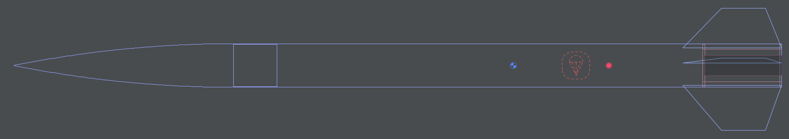
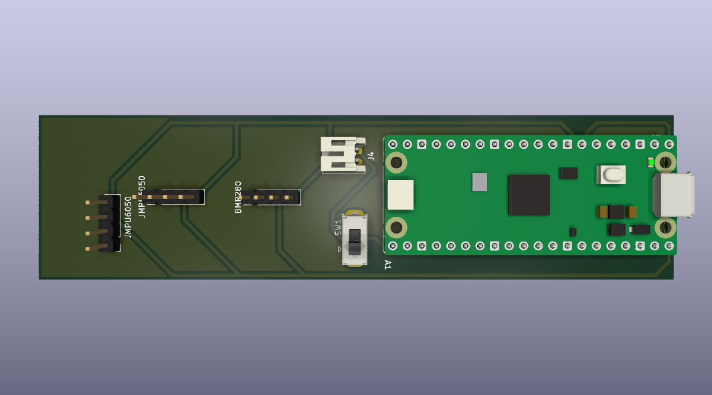

# Buzzard-01

## How I came up with the idea:

I watched a couple of [BPS.space](https://www.youtube.com/bpsspace) YouTube videos and thought *it's not gonna be that hard...*  
I remembered a c't magazine article about the program **OpenRocket** and I tried it. My final rocket was this:

## Why a PCB?

Since I was familiar with **KiCad** I decided to design my own board computer.  
I came up with this design, featuring up to 3 sensors, a Raspberry Pi Pico and a place for the battery and an ON/OFF switch:

## Future Plans / Software

The next step is writing the flight software. I will probably use **MicroPython** to read the sensor data and control the rocket.
