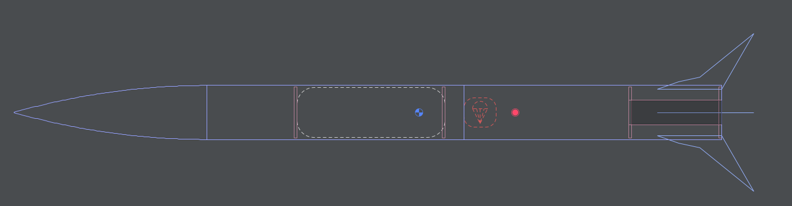
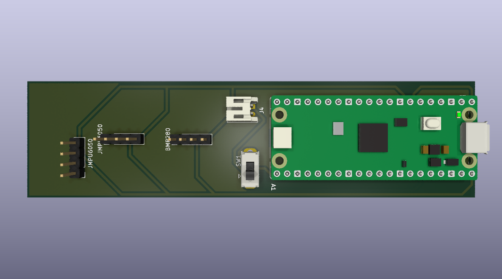

# Buzzard-01

## The Rocket

### How I came up with the idea:

I watched a couple of [BPS.space](https://www.youtube.com/bpsspace) YouTube videos and thought _it's not gonna be that hard..._  
I remembered a c't magazine article about the program **[OpenRocket](#️-required-software--toolchain)** and I tried it. My final rocket was this:

### Why a Flight Computer?

Although it sounds like overkill, to put a flight computer on to the first ever build rocket, I did it.  
Since I was familiar with **[KiCad](#️-required-software--toolchain)** I choose to design the flight computer with KiCad.  
I came up with this design, featuring up to 3 sensors, a Raspberry Pi Pico and a place for the battery and an ON/OFF switch:

### Future Plans / Software

The next step is writing the flight software. I will probably use **[MicroPython](#️-required-software--toolchain)** to read the sensor data and control the rocket.

## Use of the Files

### .ork files (OpenRocket)

Open these files with **OpenRocket** to view or modify the rocket design and simulations.

- **How to open:** In OpenRocket, press `Ctrl+O` (or `Cmd+O` on Mac), navigate to the file, and open it.

### .kicad_pcb / .kicad_sch files (KiCad)

These files contain the schematics and PCB layout for the custom flight computer.

- **How to open:** Open **KiCad**, select `File` > `Open Project`, and select the project file in this directory.

### 3D Models (.obj / .stl)

These files contain the 3D-printable components of the rocket (like the nose cone or fins) and 3D renders of the electronics.

- **How to use:** Import the `.obj` files directly into your preferred 3D printing slicer (e.g., Cura, PrusaSlicer) or a CAD program (e.g., Blender, FreeCAD) for modifications.

### 🛠️ Required Software & Toolchain

To view, modify, or build this project, you will need the following software:

| Software | Purpose / Usage | Recommended Version |
| :--- | :--- | :--- |
| **[OpenRocket](https://openrocket.info)** | Rocket flight simulation and design (`.ork` files) | v23.09 or newer |
| **[KiCad](https://kicad.org)** | PCB Design & Schematics (`.kicad_*` files) | v8.x or newer |
| **[MicroPython](https://micropython.org)** | Flight controller firmware (Raspberry Pi Pico) | v1.22+ |
| **[Thonny](https://thonny.org)** or **[VS Code](https://code.visualstudio.com/download)** | Recommended IDE for flashing and writing MicroPython | Latest |
| **Any 3D Slicer** (e.g., [Cura](https://curaslicer.com/), [PrusaSlicer](https://www.prusa3d.com/p/prusaslicer/)) | Slicing `.stl`/`.obj` files for 3D printing | - |
