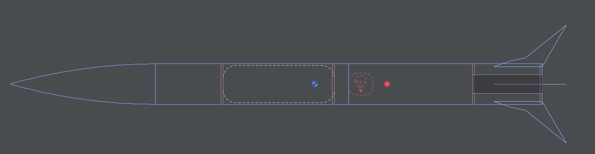

# Buzzard-01

## The Rocket

### How I came up with the idea:

I watched a couple of [BPS.space](https://www.youtube.com/bpsspace) YouTube videos and thought _it's not gonna be that hard..._  
I remembered a c't magazine article about the program **OpenRocket** and I tried it. My final rocket was this:

### Why a Flight Computer?

Although it sounds like overkill, to put a flight computer on to the first ever build rocket, I did it.  
Since I was familiar with **KiCad** I choose to design the flight computer with KiCad.  
I came up with this design, featuring up to 3 sensors, a Raspberry Pi Pico and a place for the battery and an ON/OFF switch:

### Future Plans / Software

The next step is writing the flight software. I will probably use **MicroPython** to read the sensor data and control the rocket.

## Use of the Files

### .ork files (OpenRocket)

Open these files with **OpenRocket** to view or modify the rocket design and simulations.

- **How to open:** In OpenRocket, press `Ctrl+O` (or `Cmd+O` on Mac), navigate to the file, and open it.

### .kicad_pcb / .kicad_sch files (KiCad)

These files contain the schematics and PCB layout for the custom flight computer.

- **How to open:** Open **KiCad**, select `File` > `Open Project`, and select the project file in this directory.

### 3D Models (.obj / .stl)

These files contain the 3D-printable components of the rocket (like the nose cone or fins) and 3D renders of the electronics.

- **How to use:** Import the `.stl` or `.obj` files directly into your preferred 3D printing slicer (e.g., Cura, PrusaSlicer) or a CAD program (e.g., Blender, Fusion 360) for modifications.
